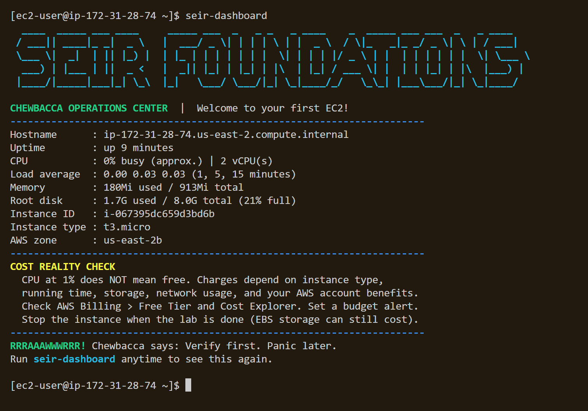
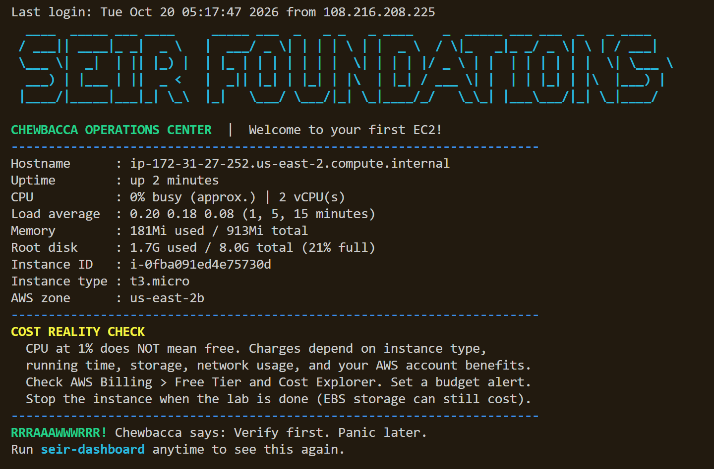
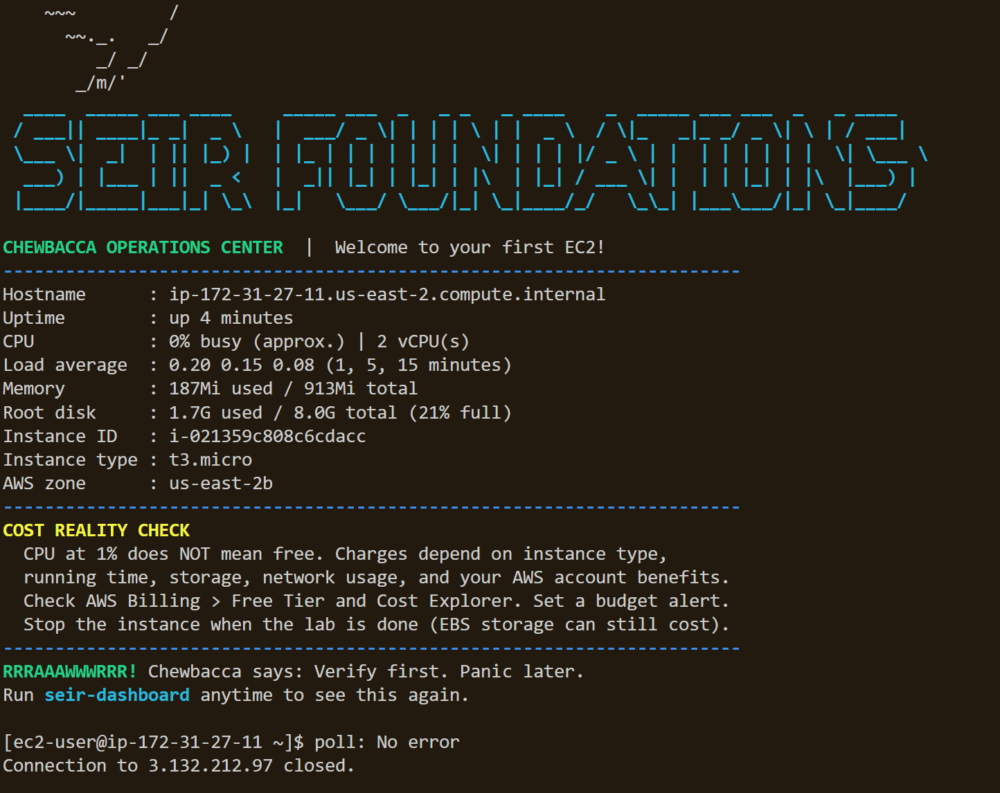

# Complete evidence table with three distinct public IPv4 addresses:

| Deployment | Public IPv4 address | Connection method | Screenshot | Instance terminated? |
|-----------|---------------------|-------------------|-----------|----------------------|
| 1 | 18.118.216.93 | SSH | deployment-1.png | Yes |
| 2 | 3.143.110.232 | SSH | deployment-2.png | Yes |
| 3 | 3.132.212.97 | SSH | deployment-3.png | Yes |

# Deployment description: (launch, SSH connection, and dashboard) 

### Log into AWS console and searched for ec2 service. Once located, launch a new instance and establish the ec2 with the following criteria: Create Name, Select relevant AMI, Create Pass key (Saved in practicle location), Select Security Group ( Open New Tab and create security group: SSH and HTTP Soure: My IP and launch ). Instance should be pre-set with free tier settings. 

### Retrieve seir ec2 Raw Code from your repository (access previously acquired) SEIR FOUNDATION. Access advance settings on AWS Console and Paste Raw code into User Data field. Click Launch instance. Allow Instance to complete processing.

## #Windows
### Open directory containing ec2 passkey via the IDE. Access the Terminal and type," ssh -i *passkey(Space) "ec2-user@" (NoSpace) *InstancePublicIP4v and press enter.

### Terminal will populate prompt regarding interest in proceeding. Type yes and the SEIR Dash board will populate.

## Deployment #1 :

## Deployment #2 :

## Deployment #3 :

## Instance Data Reflection Deployment #1:

### Host Name: ip-172-31-28-74.us-east-2b.compute.internal
Reflection:

identifies the machine on the network and
helps system know which instance you are working on

### Instance type: T3. Micro
Reflection:

The Virtual Machine size is small and suitable for light workloads.

### Availability Zone: us-east-2b
Reflection:

The Virtual Machine (EC2) is physically hosted in this region.

### CPU: 0% busy (approx.) | 2 vCPU(s)
Reflection:

The server is idle and not under heavy load.

### Memory: 180Mi used / 913Mi total
Reflection:

Roughly 20% of memory is in use, and there is plenty of memory available.

### Disk: 1.7G used / 8.0G total (21% full)
Reflection:

Only 21% of the disk is occupied, with about 6.3 GB free.

### Uptime: Up 9 minutes
Reflection:

The instance running time, initial setup.

# One thing that became easier after repeating the process:
Creating an instance became more fluid after creating 3 and working through some kinks.

# Errors encountered and resolution:

### #1 Upon accessing my ec2 instance I used the command line # ssh -i ec2-user@"my_public_IPv4" and was rejected from connecting to my AWS EC2 instance. I then investigated and confirmed my instance Passkey was required. I implemented the key in to the command line # ssh -i "Passkey" ec2-user@"my_public_IPv4". After submission I then was prompted whether I wanted to proceed. Once I acknowledged "yes" I then obtained authorization to connect to the ec2 server.  

### #2 After obtaining authorization to access the Sear Foundation output did not display. I realized that I did not apply the Raw Code from the repository when creating the ec2 instance. I terminated the ec2 and started over. After I acquired the ec2 Raw code from the reposity and applied it to my new ec2 instance I access i was able to access the EC2 via SSH and was prompted with the SEIR dashboard.

### #3 In addition I terminated my old security and created a fresh one. My inbound rules were set "SSH" and " "HTTP" and instead of using IP4V as the source I selected "My IP" to not open the "SSH" and "HTTP" ports to the entire internet.

# Practice instances clean up:
Instances Terminated

# Assignment Completion Checklist:

- [x] I connected to AWS EC2 using SSH.
- [x] I observed the SEIR dashboard raw code.
- [x] I completed three separate EC2 deployments for homework.
- [x] I successfully connected to each of the three instances.
- [x] I recorded three distinct public IPv4 addresses.
- [x] I uploaded three SEIR dashboard screenshots and explanations to my GitHub repository.
- [x] I submitted my repository link by Tuesday, October 20, 2026, noon Central Time.
- [x] I terminated unused EC2 instances